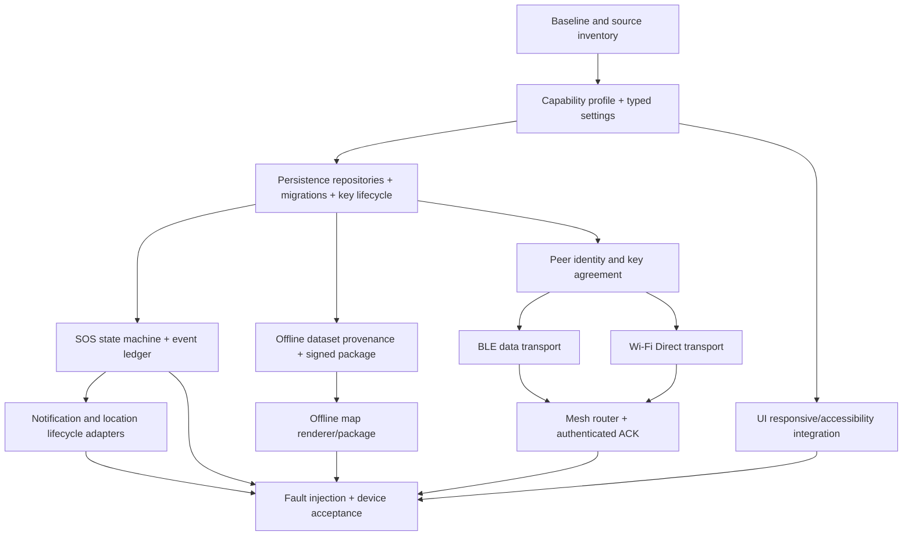

# PH-ResQ Critical Architecture Audit & Remediation Register

**Audit basis:** repository source and documents at candidate `0ef2401d0cdfb71ed34c6dbe4e3b3f746aee6f5d`, inspected 2026-11-13.
**Purpose:** Map what exists, separate implementation from specification, and order critical corrections without deleting or weakening any retained feature.
**Status:** Architecture audit and remediation plan; not a certification or claim that open work has been implemented.

## 1. Repository map (verified at audit SHA)

### Application source
- `MainActivity.kt`, `ConsentScreen.kt`: Compose entry point and UI.
- `SosStatusForegroundService.kt`: visible SOS handoff status service.
- Core: `ConsentStore`, `ResQDatabase`, `EncryptedFieldCipher`, `PinProtectedVault`, `LocalVault`, `SosState`, `SosMessage`, `FreshLocationProvider`, `LastKnownLocation`, `AdaptiveLocationPolicy`, `BleDiscoveryManager`, `MeshEnvelopeCodec`, `DurableMeshQueue`, `OfflineDataRepository`, `OfflineDatasetImporter`, `HazardDataRepository`, `EncryptedVoiceNoteRecorder`, `MedicalIdQr`, `IntegrityVerifier`, `NationalHotlineDirectory`, `Geohash`, `RollingPrivacyToken`, and `SafeVolumePolicy`.
- Persistence implementation: custom `SQLiteOpenHelper`, database schema version 7; SharedPreferences for consent/selected settings; app-private encrypted files for voice notes/mesh packets.
- Build: Kotlin + Compose, minSdk 26, compileSdk/targetSdk 35, Java 17. No Gradle wrapper is committed; CI configures Gradle externally.
- Tests: Robolectric/JUnit tests cover consent, database persistence, importer, vault, mesh codec/queue, advisories, volume, SOS model and selected security/geospatial utilities. No instrumented UI/device integration suite is evidenced in this source tree.

### Architecture collection already present
`ARCHITECTURE_COLLECTION.md`, `MASTER_PLAN.md`, `SYSTEM_ARCHITECTURE.md`, `ARCHITECTURE_DECISIONS.md`, `IMPLEMENTATION_ROADMAP.md`, `IMPLEMENTATION_STATUS.md`, `FEATURE_TRACEABILITY.md`, `DATABASE_SPEC.md`, `SECURITY_MODEL.md`, `SOS_STATE_MACHINE.md`, `MESH_PROTOCOL.md`, `TEST_ACCEPTANCE_MATRIX.md`, `TEST_AND_ACCEPTANCE_PLAN.md`, `SINGLE_PASS_DEVICE_ACCEPTANCE.md`, six phase documents, `DATA_SOURCES_AND_RISKS.md`, `OFFLINE_DATA_IMPORT.md`, `RELEASE_CANDIDATE_CHECKLIST.md`, `PRIVACY_NOTICE.md`, `PATCH_NOTES.md`, `WORK_RULES.md`, and `features_update.md`.

## 2. Findings by severity

| ID | Severity | Finding at audit SHA | Evidence/status | Required remediation |
|---|---|---|---|---|
| C-01 | P0 | Universal Android compatibility is not a valid promise | minSdk 26; no device matrix or full capability profile | Publish API 26+ tested/degraded/unsupported tiers; implement capability registry and graceful fallbacks |
| C-02 | P0 | Mesh is not operational end-to-end | BLE discovery and packet/queue primitives only; no authenticated peer key establishment, BLE data transport, Wi-Fi Direct, or relay | Implement peer identity/key agreement, BLE transport, Wi-Fi Direct, router, authenticated ACK and multi-device acceptance; never fake success |
| C-03 | P0 | SOS handoff is not delivery | Current policy opens messaging app; no carrier or recipient receipt | Durable SOS event/transition ledger, per-recipient handoff states, no duplicate resend after process death, explicit no-receipt wording |
| C-04 | P0 | Six-domain persistence/recovery is incomplete | SQLite v7 + selected encrypted fields and preferences; no complete migration/recovery/retention matrix | Implement repository boundaries, migration fixtures, key-loss/reinstall policy, transaction invariants, recovery tests |
| C-05 | P0 | Security/key lifecycle is incomplete | Keystore cipher and PIN vault exist; rotation, recovery, full field audit, reinstall behavior unresolved | Data classification, field coverage audit, fail-closed key invalidation, rotation/recovery, backup policy and adversarial tests |
| C-06 | P1 | Device adaptation is only a partial policy utility | `DeviceCapabilityProfile` is connected to a Compose device-status card and refreshes on activity resume; content width is centered/constrained for tablets; Robolectric profile tests exist. | Extend event-specific refresh and policy tests; add API 26/30/31 boundary tests, adaptive screenshots, accessibility and physical OEM matrix |
| C-07 | P1 | Location helper is not a full adaptive service | Last-known and bounded one-shot fresh fix; no lifecycle-aware polling service | Implement opt-in foreground location only where justified; persist each fix with age/accuracy; stop on permission/policy changes |
| C-08 | P1 | Offline nationwide data/maps are not packaged | JSON importer/cache and map tile metadata exist; no certified dataset, signed manifest, renderer or tile license package | Source/license audit, PSGC coverage report, authoritative LGU/evacuation feeds, signed manifests and rollback, licensed renderer |
| C-09 | P1 | UI/device acceptance is incomplete | Consent scroll fix + Compose UI Robolectric tests; no full instrumentation or physical OEM matrix | Add screenshot/layout/accessibility/permission/lifecycle instrumentation; run compact, large-font, landscape, TalkBack |
| C-10 | P1 | Remote family check-in is local-only | Local check-in and encrypted outbox; no remote transport/ack | Define authenticated endpoint, consent, retry/idempotency, privacy and honest pending/synced states |
| C-11 | P1 | Feature traceability is incomplete/stale | Feature table has 34 feature IDs; test matrix now has at least 36 test cases; statuses need crosswalk | Every F-ID maps to code, test IDs, acceptance evidence and risks; keep 34 retained features |
| C-12 | P2 | Settings and platform capabilities are fragmented | Selected SharedPreferences/app_state values; no single typed settings/capability owner | Central SettingsRepository, schema/version, defaults, UI mapping and policy validation |
| C-13 | P2 | Database is a raw SQLite helper with limited repository separation | Schema v7; direct helper used by repositories | Introduce tested repository/DAO boundaries without data reset; decide Room only with migration-safe plan |
| C-14 | P2 | Spatial index/performance not proven | coordinate B-tree + bounding box/Haversine; not R-tree; no nationwide benchmark | Benchmark realistic PSGC/emergency data on low-end hardware; choose measured index strategy |
| C-15 | P2 | Data integrity does not authenticate source | SHA-256 verifier and user-supplied metadata; no signed trusted manifest | Signed manifest, pinned publisher key rotation, package digest and rollback protection |
| C-16 | P2 | Build reproducibility gap | No committed Gradle wrapper; CI provisions Gradle externally | Pin Gradle wrapper/distribution and dependency verification; reproduce clean build |
| C-17 | P2 | Legal/privacy evidence incomplete | Privacy notice exists; no legal assessment, retention matrix or full deletion/export test | Privacy impact assessment, retention schedule, legal review and tested user controls |

## 3. Non-negotiable architecture decisions

1. Kotlin/Jetpack Compose remains the native Android application runtime; no browser/React Native APIs are substitutes for Android capabilities.
2. Preserve all 34 feature IDs and their user-facing intent. A feature may be partial/blocked on a device, but must have a documented fallback and status.
3. Device support is capability-based and versioned, not a promise of identical operation on all Android devices.
4. SOS is a durable event with explicit transport/handoff/receipt states.
5. Mesh delivery requires authenticated peer identity, real transport, and peer-bound ACK. Discovery or queue insertion is never delivery.
6. Keystore failures fail closed for protected content. No plaintext fallback.
7. SQLite schema changes are sequential, transactional, non-destructive and tested from all supported versions.
8. Settings, capabilities and UI are one contract: settings express user preference; capability policy constrains what can run; UI shows actual state.
9. Background execution is best effort within Android rules; do not promise resistance to force-stop, OEM task killers or revoked permissions.
10. CI, physical-device, data-source, security and release evidence are separate gates.

## 4. Dependency map (implementation order)

## 5. Definition of completeness

A requirement is complete only when all applicable conditions are satisfied:
- Scope retained in the feature registry and linked to a requirement ID.
- Architecture contract and platform constraints are defined.
- Production implementation is connected to UI/settings and correct Android adapter.
- Durable state, migration, retention, security and recovery behavior are defined.
- Unit/Robolectric/instrumented/integration tests pass on the current candidate SHA.
- Device-dependent behavior is tested on declared API/OEM/hardware combinations.
- Offline, denied permission, unsupported hardware, process death, reboot, low storage and failure states are exercised.
- User-facing status is truthful; no fake mesh, sent, delivered, verified or nationwide claims.
- Data source/license/provenance is accepted where data is involved.
- Documentation, feature traceability, tests, roadmap, implementation status and release checklist are updated in the same change.
- Residual risks and unsupported device combinations are recorded.

Statuses: `PROPOSED → SPECIFIED → IMPLEMENTED → AUTOMATED_TESTED → DEVICE_VERIFIED → RELEASED`. Use `PARTIAL`, `BLOCKED`, or `NOT_IMPLEMENTED` when appropriate; never skip a state based on assumption.

## 6. Audit completion and next execution gates

This audit maps the repository at the SHA above. It does not itself implement the open P0/P1 runtime features. Next: capability/settings foundation; persistence/recovery; SOS ledger; authenticated mesh transport; data pipeline; UI/accessibility; device matrix; final CI/APK audit. Keep PR #1 open and unmerged.
