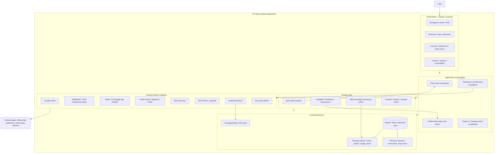
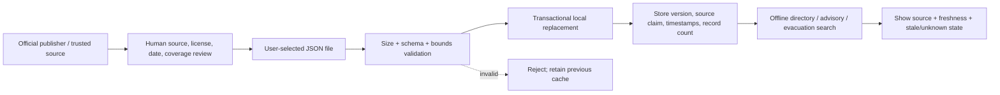
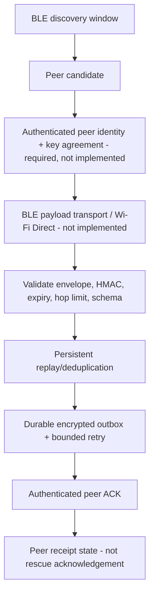

# PH-ResQ System Architecture

**Version:** 1.0  
**Updated:** 2026-11-02  
**Status:** Architecture baseline + implementation boundary. Partial implementation only.

## 1. Design intent

PH-ResQ is an Android-first emergency-assistance application designed to keep essential user-prepared information and cached public data available when connectivity is poor or absent. The app must communicate uncertainty honestly: local persistence is not delivery, opening another app is not sending a message, peer discovery is not mesh transport, and a data import is not proof of publisher authenticity.

## 2. Logical component architecture



### Component ownership

| Layer | Owns | Must not claim |
|---|---|---|
| Presentation | User intent, accessibility, visible state, confirmation | Backend authorization or transport success |
| Application orchestration | Ordering, idempotency, lifecycle coordination, handoff | Recipient delivery without a receipt |
| Domain | State transitions, validation, policy, protocol invariants | Android hardware availability |
| Persistence | Durable local records, transactional replacement, encrypted columns | Remote synchronization or trusted source identity |
| Platform adapters | Android APIs and external intents | Behavior of third-party apps, carrier, recipients, or OEM firmware |
| External systems | Messaging, dialer, official data, peer transport | Control by PH-ResQ |

## 3. SOS flow and delivery semantics

```mermaid
sequenceDiagram
    actor User
    participant UI as Compose SOS UI
    participant Core as SOS coordinator / state machine
    participant DB as Encrypted local store
    participant OS as Android notification + messaging app
    participant Recipient as Recipient / carrier

    User->>UI: Hold SOS / confirm
    UI->>Core: Create SOS event
    Core->>DB: Persist event + QUEUED
    DB-->>Core: Commit confirmed
    Core->>DB: Persist handoff attempt
    Core->>OS: Start visible status + open SMS composer
    OS-->>UI: Messaging app opened (if available)
    UI-->>User: "Opened messaging app; delivery unconfirmed"
    Note over User,Recipient: User must review and press Send in the external app.
    OS->>Recipient: Only if user sends and carrier/network accepts
    Note over Recipient: Delivery/acknowledgement is unknown unless a supported receipt is received.
```

**Required state meaning:** QUEUED = saved locally; SENDING = supported transport attempt; HANDED_OFF = external composer opened; DELIVERED = trusted delivery receipt; ACKNOWLEDGED = recipient/service acknowledgement; FAILED/CANCELLED = explicit outcome. Never transition from HANDED_OFF to DELIVERED merely because an intent succeeded.

## 4. Offline dataset lifecycle



Source URL/license/version fields inside an imported file are untrusted claims. The app currently does not authenticate the publisher with a signed manifest, fetch live feeds, certify nationwide coverage, or provide a complete map renderer/package. The user must independently obtain and review trusted data.

## 5. Mesh lifecycle and trust boundary



Current implementation includes BLE discovery and local packet/queue/ACK/replay primitives. The missing peer authentication and radio data transports mean there is no operational end-to-end mesh delivery today. Never send sensitive medical/contact/location data in BLE advertisements.

## 6. Data and security boundaries

- SQLite/local files are device-local and subject to storage corruption, uninstall, backup behavior, and device compromise.
- Android Keystore protects selected key material; key invalidation, recovery, rotation, and complete sensitive-field coverage still require acceptance.
- PIN vault lockout is a local control, not protection against a compromised or rooted device.
- Notification content and external shares cross OS/app boundaries; minimize disclosure and require user choice.
- Imported datasets and public advisories are untrusted until independently sourced and reviewed.
- Future peer devices are hostile by default until identity and keys are authenticated.

## 7. Failure behavior

| Failure | Required behavior |
|---|---|
| No internet | Use previously cached data; clearly show missing/stale coverage |
| No GPS fix / permission denied | Offer last-known fix with timestamp/accuracy or allow manual fallback; never label stale fix as current |
| No SIM / no messaging app | Preserve SOS draft locally and explain that no message was sent |
| Notification permission denied | Keep in-app state visible; report foreground notification limitation |
| Process killed / reboot | Recover durable event and pending work without duplicate dispatch |
| Corrupt or invalid import | Reject atomically; preserve previous usable dataset |
| BLE disabled / permission revoked | Stop scan safely and explain unavailable capability |
| Peer key not established | Do not trust ACK or forward sensitive packet |
| Stale advisory/evacuation record | Mark stale/unknown; direct user to official source when possible |

## 8. Runtime architecture vs planned adapters

**Present in repository, with partial scope:** Compose Android client; local SQLite database; selected encrypted fields and PIN vault; SOS state model and messaging-app handoff; location helper; voice-note record/play/share; offline directory/advisory/evacuation cache and JSON import; map tile cache metadata; BLE discovery; mesh codec/outbox/ACK/replay primitives; SOS handoff status notification.

**Not yet operational end-to-end:** nationwide datasets, licensed offline map renderer, live official feed ingestion, signed dataset update pipeline, remote family sync, SMS delivery receipts, authenticated mesh peer keys, BLE packet exchange, Wi-Fi Direct, multi-hop relay, complete key recovery, duress mode, and physical-device acceptance.

## 9. Required architecture acceptance

1. All 34 feature IDs remain in `FEATURE_TRACEABILITY.md`.
2. Every feature has implementation links, current-SHA tests, and residual-risk notes.
3. SOS transitions are durable and duplicate-safe; no false delivered status.
4. Dataset replacement is atomic and source provenance is independently reviewed.
5. Mesh multi-device tests prove authenticated peer exchange, ACK binding, replay rejection, retry/expiry, and battery behavior.
6. Permission denial, revocation, process death, reboot, offline, no-SIM, storage pressure, and corrupt-data cases are tested.
7. Accessibility review covers TalkBack, font scaling, contrast, motion, touch targets, and SOS reachability.
8. Release artifact is tied to exact source SHA; physical-device and data-coverage acceptance are separately evidenced.

See `ARCHITECTURE_COLLECTION.md` for the complete document index and source-of-truth hierarchy.
